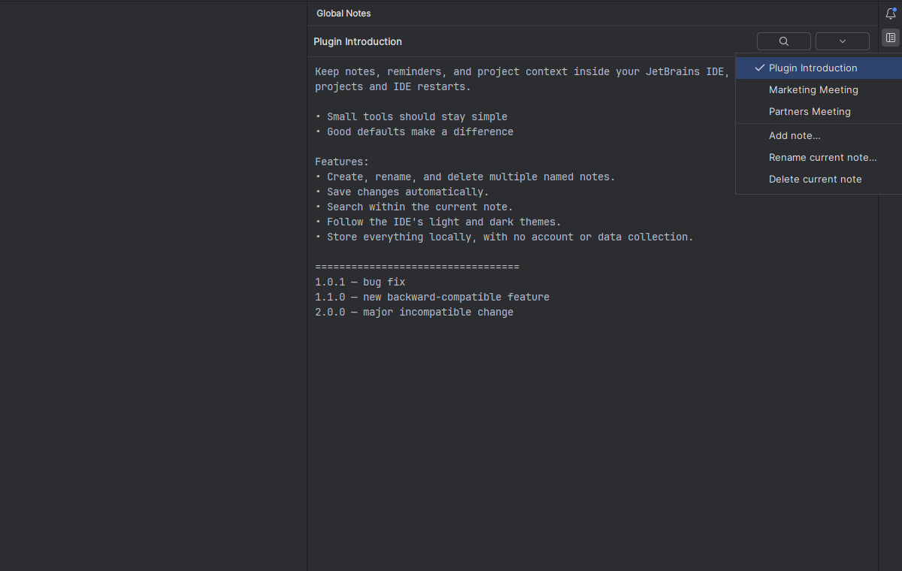
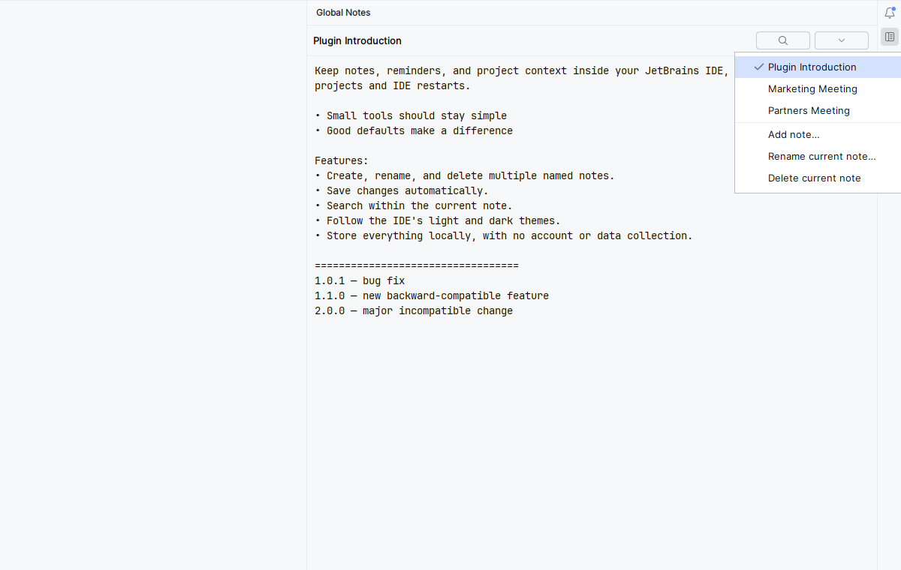

# Global Notes

Keep notes, reminders, and project context inside your JetBrains IDE, available across projects and IDE restarts.

- Small tools should stay simple
- Good defaults make a difference

## Features

- Create, rename, and delete multiple named notes.
- Save changes automatically.
- Search within the current note.
- Follow the IDE's light and dark themes.
- Store everything locally, with no account or data collection.

Open **Global Notes** from the right-hand tool-window bar. Start writing, or use the header menu to manage your notes.





## Development

Built with Kotlin and the IntelliJ Platform Gradle Plugin, targeting IntelliJ IDEA `2025.3.5`.

```powershell
.\gradlew.bat buildPlugin  # Build the installable ZIP in build/distributions
.\gradlew.bat runIde       # Run in a sandbox IDE
```

See the [changelog](CHANGELOG.md) for release details. Licensed under [Apache 2.0](LICENSE).
